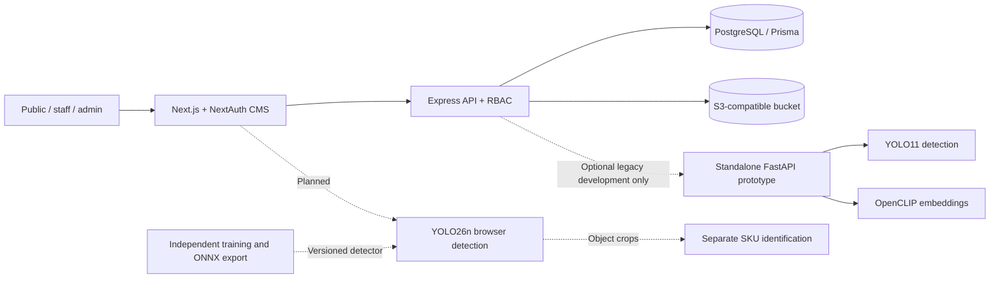

<a id="readme-top"></a>

<div align="center">

# Lensistry

**See it. Search it. Know it.**

Standalone AI-powered product/SKU catalog and shelf-photo identification proof of concept, built by **DLSU STSWENG Group 18**.

[Overview](#overview) · [Architecture](#architecture) · [Setup](#local-development) · [API](#api-contracts) · [Validation](#validation) · [Gitflow](#gitflow)

</div>

> **Implementation status:** The web deployment is configured separately from AI tooling, but deployment and live database/S3 integration still need verification. The team's YOLO26n detector has been trained independently on SKU-110K; browser integration and crop-based SKU identification are not implemented in this repository. The detection screen uses simulated results, and the main product catalog and dashboard use preview data.

## Overview

Lensistry is intended to help administrators maintain a SKU catalog and staff identify products in shelf photos. Public visitors can search catalog metadata without authentication. The API and several web routes are implemented, while the main catalog screen and browser detection workflow remain previews.

| Capability                                                | Current state                                                                                                  |
| --------------------------------------------------------- | -------------------------------------------------------------------------------------------------------------- |
| Public catalog search by name, brand or SKU               | Implemented through Express and Next.js                                                                        |
| Staff/CMS sign-in and admin-managed staff users           | NextAuth credentials with Express-issued JWT and database-backed role checks                                   |
| Product CRUD, reference photos and indexing states        | API routes and separate product pages implemented; admin modifications require authorization                   |
| Main product catalog (`/products`)                        | Static preview; create, edit and delete change local state only and reset on reload                            |
| Dashboard                                                 | Placeholder statistics and activity; not connected to live catalog data                                        |
| Shelf photo uploads and history                           | Web/API routes implemented; require object storage and database integration                                    |
| Browser inference using the team's YOLO26n detector       | Planned; requires an exported model and its input/output contract                                              |
| SKU identification from detected object crops             | Separate stage from detection; the browser workflow is not implemented                                         |
| Legacy server detection, similarity matching and indexing | Optional standalone prototype; disabled unless `AI_SERVICE_URL` is configured                                  |
| Legacy detection results and manual corrections           | API/history UI implemented for server analysis; image overlay and calibrated probabilities are not available   |
| Text embeddings / semantic natural-language search        | Not implemented; text search is database substring matching                                                    |
| Object-detector training                                  | YOLO26n trained independently on SKU-110K; training and model artifacts are maintained outside this repository |
| Asynchronous jobs and batch evaluation                    | Not implemented                                                                                                |
| Skaffld CORE sync / migration                             | Not implemented; application owns its catalog, identity and database                                           |

## Architecture

The client-aligned technology stack is:

| Layer                 | Technology                                                                                                                       |
| --------------------- | -------------------------------------------------------------------------------------------------------------------------------- |
| Frontend/CMS          | **Next.js 16**, React 19, TypeScript 7, Tailwind CSS 4, **Radix UI** via shadcn/ui                                               |
| Main backend          | **Node.js**, **Express 5**, TypeScript, Zod                                                                                      |
| Database              | **PostgreSQL 18**, **Prisma ORM 7** and reviewed SQL migrations                                                                  |
| Authentication        | NextAuth 5 credentials CMS sessions, short-lived **JWT access tokens** for API calls, backend-enforced **RBAC**                  |
| Images                | **S3-compatible storage** with presigned uploads (MinIO in development; other compatible providers configurable)                 |
| Product detector      | **YOLO26n**, trained independently on **SKU-110K**; browser integration is pending                                               |
| Standalone AI tooling | Optional Python 3.11–3.13, **FastAPI**, **PyTorch**, **Ultralytics YOLO11**, **OpenCLIP ViT-B/32**; excluded from web deployment |
| Browser inference     | Planned: exported **YOLO26n ONNX** detector with **ONNX Runtime Web**, followed by SKU identification from crops                 |
| Dependency management | Bun for JavaScript workspace; uv for Python                                                                                      |
| Tests/quality         | Node test runner, Python pytest/HTTPX, Oxlint, Oxfmt, Ruff                                                                       |



Express owns data, credential checks, privileged operations and access to storage. Next.js routes and Server Actions are the browser-facing entry points. The `/products` catalog screen currently uses fixture rows and local-only mutations; its create drawer stages photos without uploading them. Separate product creation, detail and edit routes call the API. The dashboard uses placeholder values. Neither the web build nor normal web startup installs or runs Python. `services/` is a self-contained legacy inference prototype retained for independent experimentation; the Vercel configuration excludes it and model files. No Skaffld CORE dependencies are required.

Web and Express application code share the root `src/` directory. The Express workspace is `src/api/`, with `app.ts` for deployment, `index.ts` for local startup, `modules/` for routes, `lib/` for service clients, and `prisma/` for the schema and migrations. It has no nested `src/` directory. The optional Python prototype stays in `services/` as an independent project.

The intended AI workflow is independent training → ONNX export → browser download/cache → object detection → image crops → SKU identification. Publish versioned model artifacts separately from server function bundles. The team's training work is external to this repository; no trained artifact or browser model runner is shipped here. See [the browser inference handoff](docs/browser-inference.md) and [standalone tooling setup](services/README.md).

### Detection and SKU identification

The team's **YOLO26n** model is trained on **SKU-110K** to locate products in shelf images. [SKU-110K](https://docs.ultralytics.com/datasets/detect/sku-110k/) provides bounding boxes for a single generic object class, without per-SKU labels. Detector class IDs therefore do not identify catalog SKUs.

Each detected object is cropped from the original image and passed to a separate SKU-identification step. That step must resolve a crop to a stable catalog SKU or return **Unknown** when no reliable match is available. The legacy OpenCLIP prototype demonstrates embedding-based matching; the browser identification implementation is still pending. Training a detector, indexing reference images and integrating inference are separate tasks.

### Legacy image indexing versus independent training

**Indexing** does not fine-tune a neural network. In the separate product detail flow, administrators can upload JPEG/PNG/WebP reference photos (10 MiB each) and request indexing when the legacy service is configured. The API downloads the objects, validates image contents, and asks FastAPI for a normalized OpenCLIP image embedding per reference. Prisma stores the vector and model ID, and records `PENDING → PROCESSING → INDEXED` or `FAILED`. Indexing can be retried. The current 512-dimensional vectors are kept as PostgreSQL float arrays and compared in the API for this small POC; a vector index should be considered only when catalog size warrants it.

**Legacy server detection** defaults to the general-purpose `yolo11n.pt` detector, independently of the team's trained YOLO26n model. Each bounding-box crop is embedded with the same OpenCLIP model and compared using cosine similarity to indexed reference embeddings. Similarity below `0.78` yields **Unknown**. This threshold is an **uncalibrated heuristic** and similarity is not a probability. The default YOLO11n has not been trained on the project's SKU labels, so detection coverage can be poor for packaging, crowded shelves or uncommon products. Manual corrections update the stored match and mark it as manually corrected.

These legacy requests run synchronously only when an operator explicitly configures `AI_SERVICE_URL`. With no endpoint, indexing and analysis controls are disabled and the API returns 503 before reading image bytes or changing indexing state. Catalog, sign-in, uploads and history do not require AI.

## Local development

Web prerequisites: Git, **Node.js** for the Express API, **Bun 1.4.3** and Docker Compose (Postgres/MinIO). Python and uv are needed only for optional standalone tooling. Do not put live secrets in version control.

1. Clone the repository, then run `bun install --frozen-lockfile` (use `bun install` when intentionally updating `bun.lock`). Installation generates the Prisma client; this step does not connect to a database or require `DATABASE_URL`.
2. Copy `.env.example` to `.env` at the repository root. Set independent, random **32+ character** values for `AUTH_SECRET` and `JWT_SECRET`; keep `DATABASE_URL`, `S3_*`, `API_URL` and `WEB_ORIGIN` consistent with your services. Leave `AI_SERVICE_URL` unset for normal web development. The example MinIO credentials are local-development defaults only.
3. For first-time database setup, run `docker compose up -d`, verify `DATABASE_URL`, then run `bun run db:generate` and `bun run db:migrate`. The initial reviewed SQL is in `src/api/prisma/migrations/20261030000000_initial/`. **Migrations modify the specified database**; do not run them against an unverified database.
4. Temporarily set `ADMIN_EMAIL`, `ADMIN_PASSWORD` (at least 12 characters) and optionally `ADMIN_NAME` in your shell or local env; run `bun run db:seed-admin`, then clear those values from shell history/environment where practical.
5. Run `bun run dev:all` from the repository root. It starts Compose, generates the Prisma client, and runs the web app and Express API. Open `http://localhost:3000` or `/sign-in`. No Python dependencies or model weights are installed.

Press Ctrl+C to stop the web and API processes. The Docker containers keep running; use `docker compose down` to stop them. If either application process exits, the command stops the other. The command does not run migrations or seed data. For individual processes use `bun run dev` or `bun run dev:api`.

Compose starts PostgreSQL on port **5433** (chosen to avoid a host-installed PostgreSQL on 5432) and MinIO API/console on **9000/9001**, and provisions the `lensistry` bucket. PostgreSQL and bucket provisioning may take a short time to become ready after Compose starts. Set production passwords and persistent storage separately.

The API loads the root `.env`; Prisma CLI configuration reads the same file. The API health endpoint is `GET /health` on port 4000. S3 presigned URLs are generated using the configured `S3_ENDPOINT`; the Next.js server performing the current uploads must be able to reach that endpoint. Direct API clients uploading to those URLs must also be able to reach it. In hosted deployments configure S3 CORS, private bucket permissions, TLS and actual domain origins. The initial local services are development fixtures, not hardened production configuration. All published ports bind to `127.0.0.1` only.

The Compose stack pins a Bitnami legacy MinIO build (`2025.7.23`) because MinIO withdrew its public container images; replace it with a maintained S3-compatible service before any hosted deployment. `docker compose down` stops the services and keeps data; `docker compose down -v` also deletes the PostgreSQL and MinIO volumes.

**Web environment:** `DATABASE_URL`, `API_PORT`, `API_URL`, `WEB_ORIGIN`, `AUTH_SECRET`, `JWT_SECRET`, `JWT_ISSUER`, `JWT_AUDIENCE`, `S3_ENDPOINT`, `S3_REGION`, `S3_BUCKET`, `S3_ACCESS_KEY_ID` and `S3_SECRET_ACCESS_KEY`. `AI_SERVICE_URL` is optional and enables legacy server inference only; it cannot point a hosted API at a user’s browser or local computer.

### Hosted database setup

The Prisma schema is in `src/api/prisma/schema.prisma` and reviewed migrations are in `src/api/prisma/migrations/`. Confirm those files exist in the revision you deploy. Release changes to `main` through the team's reviewed Gitflow process.

For a new, empty PostgreSQL database, set `DATABASE_URL` as a server-side secret in the environment that runs the Express API. From a trusted environment with that same database connection and the project dependencies installed, verify the target, then apply the existing migration once:

```bash
bun run --cwd src/api db:deploy
```

This runs `prisma migrate deploy`; it does not create the database. For a database that already contains tables or application data, review its migration history and take a backup before applying anything. Do not run the development migration or admin seed against an unverified database.

### Vercel Services configuration

The root `vercel.json` defines two services: public Next.js `app` at the repository root and private Express `api` at `src/api/`, with `app.ts` as its entry point. Next.js owns all public paths, including NextAuth’s `/api/auth/*`. The `app` → `api` binding injects `API_INTERNAL_URL` at function runtime; do not define it yourself. The Python `ai` service and its binding have been removed, and `.vercelignore` excludes standalone tooling and model artifacts. PyTorch, Ultralytics and OpenCLIP are excluded from this deployment configuration. Vercel Services is in beta.

Configure the database, S3, authentication and JWT settings in Vercel for each environment. Prisma client generation does not connect to the database or apply migrations; the running API still requires `DATABASE_URL`. Use hosted PostgreSQL and S3 endpoints and configure S3 CORS, private bucket access and `WEB_ORIGIN` for the deployed domain.

Run `bun run dev:vercel -L` from the repository root for local-only Vercel testing. It installs the Bun workspace once before starting the two Node services, avoiding concurrent installers racing on `node_modules`. Omit `-L` to use a linked Vercel project. Python is not required.

Remove any previously configured `AI_SERVICE_URL` from the hosted project to keep legacy server inference disabled, then redeploy this configuration. Existing deployments do not change until redeployed. Removing the Python service addresses its oversized bundle; the web deployment still needs verification. Existing server-action uploads accept up to 10 MiB but remain subject to Vercel’s 4.5 MB request-body limit; direct browser-to-storage uploads are a separate follow-up.

## API contracts

Express provides JSON endpoints, with Zod validation and role checks at the backend:

| Method            | Path                                   | Role                                      |
| ----------------- | -------------------------------------- | ----------------------------------------- |
| POST              | `/auth/login`                          | Public credential exchange (rate limited) |
| GET               | `/auth/me`                             | Signed-in                                 |
| POST              | `/auth/users`                          | Admin                                     |
| GET               | `/products`, `/products/:id`           | Public                                    |
| POST/PATCH/DELETE | `/products`, `/products/:id`           | Admin                                     |
| POST              | `/products/:id/images`                 | Admin; returns a presigned S3 PUT URL     |
| POST              | `/products/:id/index`                  | Admin; synchronous reference embedding    |
| GET/POST          | `/repository`                          | Staff/admin                               |
| POST              | `/repository/:id/analyze`              | Staff/admin; YOLO and matching            |
| GET               | `/repository/searches/recent`          | Signed-in staff/admin; own searches       |
| PATCH             | `/repository/searches/:id/matches/:id` | Search owner or admin; manual correction  |

Images are stored in S3-compatible storage; only object keys and metadata are stored in PostgreSQL. JWT validation verifies issuer, audience, expiry and the current user/role in the database. Direct API access cannot bypass these checks. NextAuth sessions are intended for the CMS; there is no public self-registration workflow.

## Validation

From the repository root:

```bash
bun run lint
bun run format:check
bun --bun next typegen
bun run typecheck
bun run typecheck:api
bun run test:api
bun run build
```

API type checking also generates the Prisma client, including after an install that skipped lifecycle scripts. Web CI has no Python job. Standalone Python tooling has its own workflow, `.github/workflows/ai-tools.yml`, triggered manually or by changes to `services/**` or that workflow on the configured branches and pull requests; it installs lightweight test dependencies. See `services/README.md` for local commands. Model export and browser inference need separate validation with the team’s weights and representative product images. There are currently no configured Playwright browser tests or measured accuracy benchmarks; a passing static build or mocked unit tests do **not** prove production readiness.

**Proposed POC acceptance gates (to confirm with client; none measured yet):** evaluate a held-out, SKU-stratified set of annotated shelf photos including lookalike packaging, occlusion, varying angles and lighting; target detector `mAP@0.5 ≥ 0.75` and recall `≥ 0.80`; top-1 SKU identification accuracy `≥ 0.90` on correctly detected known objects; unknown-product false acceptance `≤ 5%`. Also report end-to-end precision/recall, error by SKU and camera-angle subgroup, latency p50/p95, and manual-correction rate. Calibrate the matching threshold only on a validation split, then freeze it for test data.

## Roadmap and limitations

Remaining integration work includes connecting the main product catalog and dashboard to live data, verifying PostgreSQL/S3 flows, validating and exporting the trained detector, implementing browser detection and crop-based SKU identification, and measuring device performance. The detection screen remains a simulated review UI until those stages are connected. Browser-result persistence needs backend validation. File lifecycle cleanup, natural-language retrieval and versioned Skaffld integration remain outside the implemented scope. See `docs/browser-inference.md` for the model handoff. Avoid claiming these as shipped until implemented and verified.

## Gitflow

Use `feature/*` branches from `development`, propose pull requests back to `development`, and require passing CI, QA review and at least one approval before merge. `release/*` branches stage approved releases, while `hotfix/*` handles urgent mainline fixes. Never push directly to the protected `main` or `development` branches. Web CI checks lint, formatting, web/API types, unit tests and the web build; standalone Python tooling is checked separately; configure branch protections in GitHub separately.

## Contributing

Keep web and Express application code under `src/`. Use the simplest direct implementation for each code file: focused functions, clear names and only the helpers needed by current behavior. Work in small vertical feature slices, validate inputs and RBAC on every server boundary, never commit credentials, model weights or customer images, and document tests and integration limitations in PR descriptions. Review database migrations against the targeted database before applying.

<!-- TEAM -->

## Team

**De La Salle University–Manila**  
**College of Computer Studies**  
**STSWENG Group 18 · Term 1, A.Y. 2026–2027**

| Team member            | Email                              | Section | Primary role  | Secondary role |
| ---------------------- | ---------------------------------- | ------- | ------------- | -------------- |
| Carlo Gabriel Barreo   | <carlo_barreo@dlsu.edu.ph>         | S06     | QA            | Ops            |
| Hadjj Garcia           | <hadjj_garcia@dlsu.edu.ph>         | S06     | Analyst       | —              |
| John Benedict Garcia   | <john_benedict_garcia@dlsu.edu.ph> | S03     | Developer     | QA             |
| James Ryan Guinto      | <james_guinto@dlsu.edu.ph>         | S06     | Analyst       | QA             |
| Kim Francis Herrera    | <kim_herrera@dlsu.edu.ph>          | S06     | Ops           | Product Owner  |
| Rintaro Iwata          | <rintaro_iwata@dlsu.edu.ph>        | S06     | Developer     | Ops            |
| James Benedict Marquez | <james_marquez@dlsu.edu.ph>        | S06     | Product Owner | Analyst        |
| Bryce Jeswin See       | <bryce_see@dlsu.edu.ph>            | S03     | QA            | Ops            |

<p align="right">(<a href="#readme-top">back to top</a>)</p>

<!-- LICENSE -->

## License

**Proprietary / All Rights Reserved.**

This project and its source code, documentation, designs, models, and assets are proprietary. No part may be copied, modified, distributed, sublicensed, or used in any form without prior written permission from the copyright holder. Access to this repository does not grant any license or ownership rights.

<p align="right">(<a href="#readme-top">back to top</a>)</p>

<!-- CONTACT -->

## Contact

For project-related questions, contact the **STSWENG Group 18** maintainers through the project's GitHub repository once its location and issue-reporting process have been published. Client contact details are intentionally not included in this public-facing README.

<p align="right">(<a href="#readme-top">back to top</a>)</p>

<!-- ACKNOWLEDGMENTS -->

## Acknowledgments

- **De La Salle University–Manila, College of Computer Studies** — academic project setting.
- **Project client and reviewers** — requirements and feedback informing the product proposal and development plan.
- **[Best-README-Template by othneildrew](https://github.com/othneildrew/Best-README-Template)** — README structure adapted from [`BLANK_README.md`](https://github.com/othneildrew/Best-README-Template/blob/main/BLANK_README.md).

<p align="right">(<a href="#readme-top">back to top</a>)</p>
