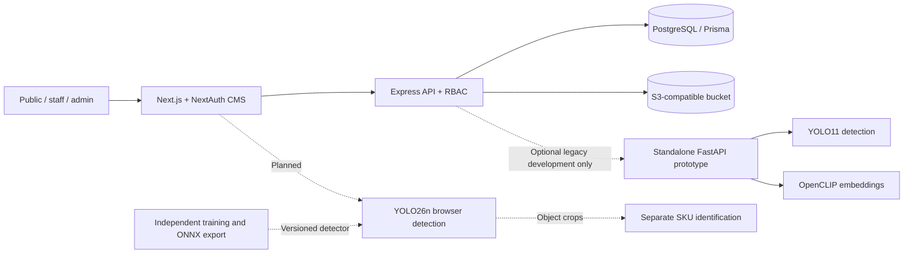

<a id="readme-top"></a>

<div align="center">

# Lensistry

**See it. Search it. Know it.**

Standalone AI-powered product/SKU catalog and shelf-photo identification proof of concept, built by **DLSU STSWENG Group 18**.

[Overview](#overview) · [Architecture](#architecture) · [Setup](#local-development) · [API](#api-contracts) · [Validation](#validation) · [Gitflow](#gitflow)

</div>

> **Implementation status:** The app uses real NextAuth accounts, an Express API and PostgreSQL through Prisma. The frontend preview mode and its temporary stores have been removed. The grocery dataset contains 18 fictional products and brands suited to stores in the Philippines; all interface text stays in English. Photo uploads use private S3-compatible storage. Photo recognition stays unavailable until an explicit analysis service is connected. The trained browser detector and email-based password recovery are not shipped.

## Overview

Lensistry helps a grocery team keep product details and photos in one place. Store managers maintain products and staff accounts; staff browse products, save shelf photos and review the results of their current photo search. Visitors can browse products without signing in. A product code identifies one product and pack size.

| Page              | Current behavior                                                                                                                                                    |
| ----------------- | ------------------------------------------------------------------------------------------------------------------------------------------------------------------- |
| Overview          | Counts and recent products come from PostgreSQL.                                                                                                                    |
| Products          | Search, pagination, create, edit and delete use the API and persist after reload. Only managers can change product details. Product codes are read-only in the app. |
| Find from a photo | Finds products in a saved shelf photo when the optional analysis service is configured. Results and manual corrections are available in the current search.         |
| Photos            | Shelf photos can be uploaded to private S3 storage and deleted by managers. The Product photos tab shows which products have photos ready for image search.         |
| Staff             | Managers can list staff, create staff or manager accounts, and reset staff passwords.                                                                               |
| Profile           | Reads and saves the signed-in user’s real name and email.                                                                                                           |
| Browse products   | Browse by name, brand, or product code without signing in. Signed-in users can search with a product photo when the embedding service is configured.                |
| Sign-up           | Creates a browsing-only account. Staff access is granted by a store manager.                                                                                        |
| Password help     | Directs users to their store manager; no reset email is claimed or sent.                                                                                            |

JWT access checks re-read the user’s database role. Password changes invalidate older API tokens. No preview identity or browser-only role can grant access to store data.

In the workspace, **Ctrl+K** or **Command+K** opens product suggestions and page shortcuts. Recently opened suggestions stay in the current browser tab. The profile is available from the name at the bottom of the sidebar.

The sidebar’s **Page guide** explains the available pages with everyday grocery examples. Its table uses the same page list as the navigation, shows only pages available to the account, and can be copied as Markdown for a review.

## Architecture

The client-aligned technology stack is:

| Layer                 | Technology                                                                                                                       |
| --------------------- | -------------------------------------------------------------------------------------------------------------------------------- |
| Frontend/CMS          | **Next.js 16**, React 19, TypeScript 7, Tailwind CSS 4, **Radix UI** via shadcn/ui                                               |
| Main backend          | **Node.js**, **Express 5**, TypeScript, Zod                                                                                      |
| HTTP client           | **Axios** for web-to-API calls, presigned image uploads and optional AI service requests                                         |
| Database              | **PostgreSQL 18**, **pgvector**, **Prisma ORM 7** and reviewed SQL migrations                                                    |
| Authentication        | NextAuth 5 credentials CMS sessions, short-lived **JWT access tokens** for API calls, backend-enforced **RBAC**                  |
| Images                | **S3-compatible storage** with presigned uploads (local filesystem service or optional Docker MinIO in development)              |
| Product detector      | **YOLO26n**, trained independently on **SKU-110K**; browser integration is pending                                               |
| Standalone AI tooling | Optional Python 3.11–3.13, **FastAPI**, **PyTorch**, **Ultralytics YOLO11**, **OpenCLIP ViT-B/32**; excluded from web deployment |
| Browser inference     | Planned: exported **YOLO26n ONNX** detector with **ONNX Runtime Web**, followed by SKU identification from crops                 |
| Dependency management | Bun for JavaScript workspace; uv for Python                                                                                      |
| Tests/quality         | Node test runner, Python pytest/HTTPX, Oxlint, Oxfmt, Ruff                                                                       |



Express owns data, credential checks, privileged operations and private storage. Next.js pages and Server Actions are the browser-facing interface. All application pages use the API rather than local fixture stores. Photos go directly from the browser to S3 and are registered only after the API verifies the file type and size. Neither the web build nor normal web startup requires Python, model files or Skaffld CORE. `services/` remains a separate legacy analysis prototype.

Web and Express application code share the root `src/` directory. The Express workspace is `src/api/`, with `app.ts` for deployment, `index.ts` for local startup, `modules/` for routes, `lib/` for service clients, and `prisma/` for the schema and migrations. It has no nested `src/` directory. The optional Python prototype stays in `services/` as an independent project.

The intended AI workflow is independent training → ONNX export → browser download/cache → object detection → image crops → SKU identification. Publish versioned model artifacts separately from server function bundles. The team's training work is external to this repository; no trained artifact or browser model runner is shipped here. See [the browser inference handoff](docs/browser-inference.md) and [standalone tooling setup](services/README.md).

### Detection and SKU identification

The team's **YOLO26n** model is trained on **SKU-110K** to locate products in shelf images. [SKU-110K](https://docs.ultralytics.com/datasets/detect/sku-110k/) provides bounding boxes for a single generic object class, without per-SKU labels. Detector class IDs therefore do not identify catalog SKUs.

Each detected object is cropped from the original image and passed to a separate SKU-identification step. That step must resolve a crop to a stable catalog SKU or return **Unknown** when no reliable match is available. The legacy OpenCLIP prototype demonstrates embedding-based matching; the browser identification implementation is still pending. Training a detector, indexing reference images and integrating inference are separate tasks.

### Legacy image indexing versus independent training

**Indexing** does not fine-tune a neural network. In the separate product detail flow, administrators can upload JPEG/PNG/WebP reference photos (10 MiB each) and request indexing when the legacy service is configured. The API downloads the objects, validates image contents, and asks FastAPI for a normalized OpenCLIP image embedding per reference. Prisma stores the vector and model ID, and records `PENDING → PROCESSING → INDEXED` or `FAILED`. Indexing can be retried. PostgreSQL generates a 512-dimensional pgvector column from compatible existing and new embeddings. Matching uses exact cosine distance in PostgreSQL and ranks each product by its closest prepared photo. Existing compatible photos do not require reprocessing.

**Legacy server detection** defaults to the general-purpose `yolo11n.pt` detector, independently of the team's trained YOLO26n model. Each bounding-box crop is embedded with the same OpenCLIP model and compared using cosine similarity to indexed reference embeddings. Similarity below `0.78` yields **Unknown**. This threshold is an **uncalibrated heuristic** and similarity is not a probability. The default YOLO11n has not been trained on the project's SKU labels, so detection coverage can be poor for packaging, crowded shelves or uncommon products. Manual corrections update the stored match and mark it as manually corrected.

**Search by image** on `/search` embeds one uploaded JPG, PNG, or WebP (up to 3 MB) and returns up to eight distinct products with a similarity of at least `0.78`. A signed-in browsing, staff, or manager account can use it. The query photo is processed in memory. Saved shelf and product photos keep their 10 MB upload limit.

These requests run synchronously only when an operator explicitly configures `AI_SERVICE_URL`. With no endpoint, indexing and analysis controls are disabled and the API returns 503 before reading image bytes or changing indexing state. Catalog browsing, sign-in and saved-photo management do not require AI.

## Local development

### Run with local photo storage

1. Run `bun install --frozen-lockfile`.
2. Configure the root `.env` with your PostgreSQL URL and independent `AUTH_SECRET` and `JWT_SECRET` values. Preserve an existing `.env`; do not replace hosted credentials with example values.
3. For the local filesystem-backed S3 service, use `S3_ENDPOINT=http://localhost:9000`, `S3_BUCKET=lensistry` and the local access key and secret `S3RVER`. `WEB_ORIGIN` sets the allowed browser origin. This development service binds only to `127.0.0.1`, requires signed requests, and keeps files in the git-ignored `.local/storage/` directory after restart. It is not a hosted storage service.
4. Run `bun run dev:all` (or `bun run dev:local`) to start storage, Express and Next.js together without Docker. This uses the PostgreSQL database configured in `.env`; it does not start a database, run migrations or seed data. Individual commands are `bun run dev:storage`, `bun run dev:api` and `bun run dev`.
5. Open `/sign-in` and use a real account. The verified existing database already contains a store-manager account; do not reset it merely to run the app. For a new database, follow the reviewed migration and admin setup below.
6. After verifying the target database, run `bun run db:seed-groceries` to add the 18 fictional groceries. This command skips existing product codes and never changes accounts, existing products, photos, history or photo readiness.

The launcher checks required settings and ports before starting services. Running `bun run dev:all` again while it is active prints the app URL and exits successfully. Stop the original command with Ctrl+C to stop all three services before restarting. If another program occupies a required port, the launcher explains which setting to change and leaves that program running. Stale launcher locks are cleared automatically. Hosted or separately managed S3 storage is used directly; the local storage process starts only for localhost endpoints with the `S3RVER` credentials.

Public registration creates a browsing account, not staff access. A manager adds staff through the Staff page. Password help explains the manager-assisted reset path; email recovery is not implemented.

To switch to a hosted S3-compatible bucket, change the `S3_*` settings in `.env`, configure bucket CORS for the deployed web origin, and restart the API. Existing local objects must be copied with their object keys before their database records can resolve against the new bucket. `.local/` is excluded from Git and deployment uploads. A deployed API cannot use this computer’s localhost storage.

The old `NEXT_PUBLIC_FRONTEND_PREVIEW` switch is no longer used. The UI is English-only, including product codes, date displays and page labels.

### Optional Docker services and first-time database setup

Web prerequisites: Git, **Node.js** for the Express API, **Bun 1.4.3** and Docker Compose (Postgres/MinIO). Python and uv are needed only for optional standalone tooling. Do not put live secrets in version control.

1. Clone the repository, then run `bun install --frozen-lockfile` (use `bun install` when intentionally updating `bun.lock`). Installation generates the Prisma client; this step does not connect to a database or require `DATABASE_URL`.
2. Copy `.env.example` to `.env` at the repository root. Set independent, random **32+ character** values for `AUTH_SECRET` and `JWT_SECRET`; keep `DATABASE_URL`, `S3_*`, `API_URL` and `WEB_ORIGIN` consistent with your services. Leave `AI_SERVICE_URL` unset for normal web development. For Docker MinIO, set the S3 keys to the credentials configured in Compose. The example S3RVER keys belong to the separate filesystem service.
3. For first-time database setup, run `docker compose up -d`, verify `DATABASE_URL`, then run `bun run db:generate` and `bun run db:migrate`. The Compose database image includes pgvector. If you bring your own PostgreSQL instance, make the `vector` extension available to the migration role before applying the migrations. **Migrations modify the specified database**; do not run them against an unverified database.
4. Temporarily set `ADMIN_EMAIL`, `ADMIN_PASSWORD` (at least 12 characters) and optionally `ADMIN_NAME` in your shell or local env; run `bun run db:seed-admin`, then clear those values from shell history/environment where practical.
5. Run `bun run dev:docker` from the repository root. It starts Compose, generates the Prisma client, and runs the web app and Express API. Docker must be installed and running. Open `http://localhost:3000` or `/sign-in`. No Python dependencies or model weights are installed.

Press Ctrl+C to stop the web and API processes. The Docker containers keep running; use `docker compose down` to stop them. If either application process exits, the command stops the other. The command does not run migrations or seed data. For individual processes use `bun run dev` or `bun run dev:api`.

Compose starts PostgreSQL on port **5433** (chosen to avoid a host-installed PostgreSQL on 5432) and MinIO API/console on **9000/9001**, and provisions the `lensistry` bucket. PostgreSQL and bucket provisioning may take a short time to become ready after Compose starts. Set production passwords and persistent storage separately.

The API loads the root `.env`; Prisma CLI configuration reads the same file. The API health endpoint is `GET /health` on port 4000. S3 presigned URLs are generated using the configured `S3_ENDPOINT`; the uploading browser must be able to reach that endpoint. The Express API must also reach it to validate saved files. In hosted deployments configure S3 CORS, private bucket permissions, TLS and actual domain origins. The initial local services are development fixtures, not hardened production configuration. All published ports bind to `127.0.0.1` only.

The Compose stack pins a Bitnami legacy MinIO build (`2025.7.23`) because MinIO withdrew its public container images; replace it with a maintained S3-compatible service before any hosted deployment. `docker compose down` stops the services and keeps data; `docker compose down -v` also deletes the PostgreSQL and MinIO volumes.

**Web environment:** `DATABASE_URL`, `API_PORT`, `API_URL`, `WEB_ORIGIN`, `AUTH_SECRET`, `JWT_SECRET`, `JWT_ISSUER`, `JWT_AUDIENCE`, `S3_ENDPOINT`, `S3_REGION`, `S3_BUCKET`, `S3_ACCESS_KEY_ID` and `S3_SECRET_ACCESS_KEY`. `AI_SERVICE_URL` is optional and enables legacy server inference only; it cannot point a hosted API at a user’s browser or local computer.

### Hosted database setup

The Prisma schema is in `src/api/prisma/schema.prisma` and reviewed migrations are in `src/api/prisma/migrations/`. Confirm those files exist in the revision you deploy. Release changes to `main` through the team's reviewed Gitflow process.

For a new, empty PostgreSQL database, set `DATABASE_URL` as a server-side secret in the environment that runs the Express API. From a trusted environment with that same database connection and the project dependencies installed, verify the target, then apply the reviewed migrations. The database host must provide pgvector, and the migration role must be able to enable it:

```bash
bun run --cwd src/api db:deploy
```

This runs `prisma migrate deploy`; it does not create the database. For a database that already contains tables or application data, review its migration history and take a backup before applying anything. Do not run the development migration or admin seed against an unverified database.

### Vercel Services configuration

The root `vercel.json` defines two services: public Next.js `app` at the repository root and private Express `api` at `src/api/`, with `app.ts` as its entry point. Next.js owns all public paths, including NextAuth’s `/api/auth/*`. The `app` → `api` binding injects `API_INTERNAL_URL` at function runtime; do not define it yourself. The Python `ai` service and its binding have been removed, and `.vercelignore` excludes standalone tooling and model artifacts. PyTorch, Ultralytics and OpenCLIP are excluded from this deployment configuration. Vercel Services is in beta.

Configure the database, S3, authentication and JWT settings in Vercel for each environment. Prisma client generation does not connect to the database or apply migrations; the running API still requires `DATABASE_URL`. Use hosted PostgreSQL and S3 endpoints and configure S3 CORS, private bucket access and `WEB_ORIGIN` for the deployed domain.

Run `bun run dev:vercel -L` from the repository root for local-only Vercel testing. It installs the Bun workspace once before starting the two Node services, avoiding concurrent installers racing on `node_modules`. Omit `-L` to use a linked Vercel project. Python is not required.

Remove any previously configured `AI_SERVICE_URL` from the hosted project to keep legacy server inference disabled, then redeploy this configuration. Existing deployments do not change until redeployed. Removing the Python service addresses its oversized bundle; the web deployment still needs verification. Browser-to-storage photo uploads avoid sending photo bytes through Next.js Server Actions. The API verifies image signatures and the 10 MiB size limit before registering a completed upload.

## API contracts

Express provides JSON endpoints, with Zod validation and role checks at the backend:

| Method            | Path                                   | Role                                        |
| ----------------- | -------------------------------------- | ------------------------------------------- |
| POST              | `/auth/register`                       | Public; creates browsing accounts only      |
| GET/PATCH         | `/auth/me`                             | Signed-in; own profile                      |
| GET               | `/auth/users`                          | Manager                                     |
| PATCH             | `/auth/users/:id/password`             | Manager; staff password reset               |
| POST              | `/auth/login`                          | Public credential exchange (rate limited)   |
| POST              | `/auth/users`                          | Admin                                       |
| GET               | `/products`, `/products/:id`           | Public                                      |
| GET               | `/products/image-search/status`        | Public                                      |
| POST              | `/products/image-search`               | Signed-in; transient product-photo matching |
| POST/PATCH/DELETE | `/products`, `/products/:id`           | Admin                                       |
| POST              | `/products/:id/images`                 | Admin; returns a presigned S3 PUT URL       |
| POST              | `/products/:id/images/complete`        | Admin; validates and records a photo        |
| GET               | `/products/:id/images`                 | Staff/admin; private photo links            |
| POST              | `/products/:id/index`                  | Admin; synchronous reference embedding      |
| GET/POST          | `/repository`                          | Staff/admin                                 |
| POST              | `/repository/:id/complete`             | Staff/admin; validates and records a photo  |
| DELETE            | `/repository/:id`                      | Admin                                       |
| POST              | `/repository/:id/analyze`              | Staff/admin; YOLO and matching              |
| GET               | `/repository/searches/recent`          | Signed-in staff/admin; own searches         |
| PATCH             | `/repository/searches/:id/matches/:id` | Search owner or admin; manual correction    |

Images are stored in S3-compatible storage; only object keys and metadata are stored in PostgreSQL. JWT validation verifies issuer, audience, expiry and the current user/role in the database. Direct API access cannot bypass these checks. NextAuth sessions provide the browser interface. Public sign-up creates a real PUBLIC browsing account; manager-created accounts use STAFF or ADMIN. The API rechecks database roles and credential versions on every protected request.

## Validation

From the repository root:

```bash
bun run lint
bun run format:check
bun --bun next typegen
bun run typecheck
bun run typecheck:api
bun run test:api
bun run build
```

API type checking also generates the Prisma client, including after an install that skipped lifecycle scripts. Web CI has no Python job. Standalone Python tooling has its own workflow, `.github/workflows/ai-tools.yml`, triggered manually or by changes to `services/**` or that workflow on the configured branches and pull requests; it installs lightweight test dependencies. See `services/README.md` for local commands. Model export and browser inference need separate validation with the team’s weights and representative product images. There are currently no configured Playwright browser tests or measured accuracy benchmarks; a passing static build or mocked unit tests do **not** prove production readiness.

**Proposed POC acceptance gates (to confirm with client; none measured yet):** evaluate a held-out, SKU-stratified set of annotated shelf photos including lookalike packaging, occlusion, varying angles and lighting; target detector `mAP@0.5 ≥ 0.75` and recall `≥ 0.80`; top-1 SKU identification accuracy `≥ 0.90` on correctly detected known objects; unknown-product false acceptance `≤ 5%`. Also report end-to-end precision/recall, error by SKU and camera-angle subgroup, latency p50/p95, and manual-correction rate. Calibrate the matching threshold only on a validation split, then freeze it for test data.

## Roadmap and limitations

Remaining work includes connecting and evaluating the team’s trained browser detector, implementing crop-based product identification and email-based account recovery, and verifying the final hosted deployment. Photo search does not show synthetic boxes or scores. The optional legacy server service is enabled only with `AI_SERVICE_URL`. Account and catalog flows require the configured database and running API; photo flows also need reachable object storage. Cleanup of abandoned saved-photo uploads, natural-language retrieval and versioned Skaffld integration remain outside the implemented scope. See `docs/browser-inference.md` for the model handoff. A passing build does not establish deployment readiness or model accuracy.

## Gitflow

Use `feature/*` branches from `development`, propose pull requests back to `development`, and require passing CI, QA review and at least one approval before merge. `release/*` branches stage approved releases, while `hotfix/*` handles urgent mainline fixes. Never push directly to the protected `main` or `development` branches. Web CI checks lint, formatting, web/API types, unit tests and the web build; standalone Python tooling is checked separately; configure branch protections in GitHub separately.

## Contributing

Keep web and Express application code under `src/`. Use the simplest direct implementation for each code file: focused functions, clear names and only the helpers needed by current behavior. Work in small vertical feature slices, validate inputs and RBAC on every server boundary, never commit credentials, model weights or customer images, and document tests and integration limitations in PR descriptions. Review database migrations against the targeted database before applying.

<!-- TEAM -->

## Team

**De La Salle University–Manila**  
**College of Computer Studies**  
**STSWENG Group 18 · Term 1, A.Y. 2026–2027**

| Team member            | Email                              | Section | Primary role  | Secondary role |
| ---------------------- | ---------------------------------- | ------- | ------------- | -------------- |
| Carlo Gabriel Barreo   | <carlo_barreo@dlsu.edu.ph>         | S06     | QA            | Ops            |
| Hadjj Garcia           | <hadjj_garcia@dlsu.edu.ph>         | S06     | Analyst       | —              |
| John Benedict Garcia   | <john_benedict_garcia@dlsu.edu.ph> | S03     | Developer     | QA             |
| James Ryan Guinto      | <james_guinto@dlsu.edu.ph>         | S06     | Analyst       | QA             |
| Kim Francis Herrera    | <kim_herrera@dlsu.edu.ph>          | S06     | Ops           | Product Owner  |
| Rintaro Iwata          | <rintaro_iwata@dlsu.edu.ph>        | S06     | Developer     | Ops            |
| James Benedict Marquez | <james_marquez@dlsu.edu.ph>        | S06     | Product Owner | Analyst        |
| Bryce Jeswin See       | <bryce_see@dlsu.edu.ph>            | S03     | QA            | Ops            |

<p align="right">(<a href="#readme-top">back to top</a>)</p>

<!-- LICENSE -->

## License

**Proprietary / All Rights Reserved.**

This project and its source code, documentation, designs, models, and assets are proprietary. No part may be copied, modified, distributed, sublicensed, or used in any form without prior written permission from the copyright holder. Access to this repository does not grant any license or ownership rights.

<p align="right">(<a href="#readme-top">back to top</a>)</p>

<!-- CONTACT -->

## Contact

For project-related questions, contact the **STSWENG Group 18** maintainers through the project's GitHub repository once its location and issue-reporting process have been published. Client contact details are intentionally not included in this public-facing README.

<p align="right">(<a href="#readme-top">back to top</a>)</p>

<!-- ACKNOWLEDGMENTS -->

## Acknowledgments

- **De La Salle University–Manila, College of Computer Studies** — academic project setting.
- **Project client and reviewers** — requirements and feedback informing the product proposal and development plan.
- **[Best-README-Template by othneildrew](https://github.com/othneildrew/Best-README-Template)** — README structure adapted from [`BLANK_README.md`](https://github.com/othneildrew/Best-README-Template/blob/main/BLANK_README.md).

<p align="right">(<a href="#readme-top">back to top</a>)</p>
