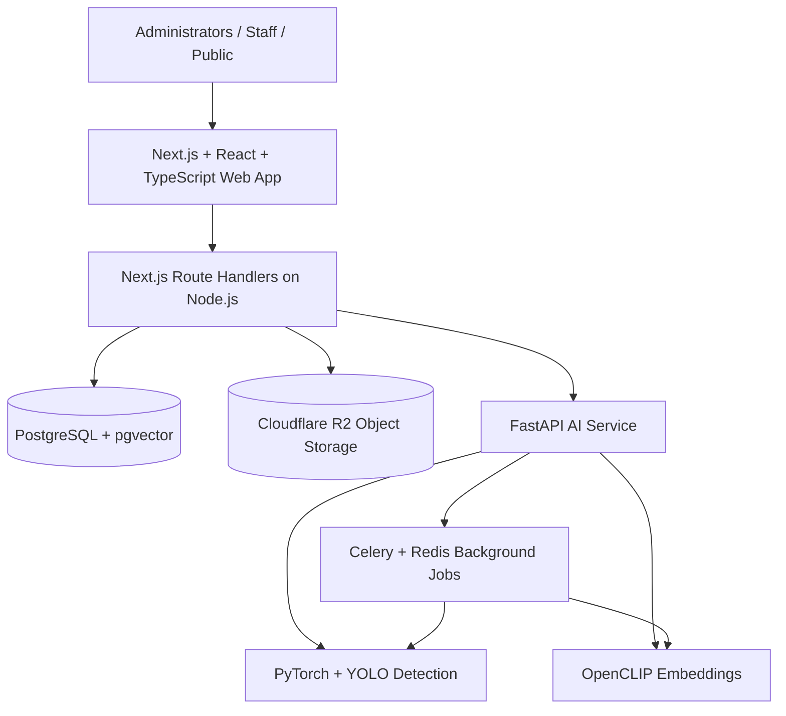

<a id="readme-top"></a>

<!-- Based on othneildrew/Best-README-Template's BLANK_README.md, adapted for STSWENG Group 18. -->

<div align="center">

# Lensistry

**See it. Search it. Know it.**

An **AI-powered product library** for organizing product information, finding products through text or images, and detecting multiple products in a single photograph.

[](#roadmap)
[](#team)
[](#built-with)
[](#built-with)

[About](#about-the-project) · [Features](#planned-features) · [Technology](#built-with) · [Getting Started](#getting-started) · [Contributing](#contributing)

</div>

> [!NOTE]
> Lensistry is the **proposed product name** for the AI-enabled Product Library developed by **De La Salle University–Manila, STSWENG Group 18** (1st Term, A.Y. 2026–2027). This README documents the project's **planned scope and selected technologies**. Features, integrations, and deployment should not be considered live until implemented and verified.

<details>
  <summary><strong>Table of Contents</strong></summary>

1. [About the Project](#about-the-project)
   - [Who It's For](#who-its-for)
   - [Planned Features](#planned-features)
   - [How It Works](#how-it-works)
2. [Built With](#built-with)
3. [System Architecture](#system-architecture)
4. [Getting Started](#getting-started)
   - [Prerequisites](#prerequisites)
   - [Local Setup](#local-setup)
5. [Usage](#usage)
6. [Roadmap](#roadmap)
7. [Development Workflow](#development-workflow)
8. [Quality Assurance and CI](#quality-assurance-and-ci)
9. [Contributing](#contributing)
10. [Team](#team)
11. [License](#license)
12. [Contact](#contact)
13. [Acknowledgments](#acknowledgments)

</details>

<!-- ABOUT THE PROJECT -->

## About the Project

**Lensistry** is a proposed centralized product information and visual-search platform. It addresses the difficulty of locating and identifying products across a growing collection of product records, reference images, and photos captured in stores, on shelves, or in other environments.

The system is designed to learn visual characteristics from reference images, support AI-generated searchable product descriptions, and let users search by **product name, natural-language description, or uploaded image**. Its planned AI pipeline combines **object detection** for finding several products in one image with **image/text embeddings** for similarity-based retrieval.

The product library is intended to be adaptable to different industries and product categories rather than being limited to a specific brand or retail setting.

### Who It's For

| User                                  | Intended use                                                                               |
| ------------------------------------- | ------------------------------------------------------------------------------------------ |
| **Company administrators**            | Maintain product/SKU records, upload reference images, and manage the centralized catalog. |
| **New employees and warehouse staff** | Learn about and identify unfamiliar products using text or visual search.                  |
| **General public**                    | Search for and identify products using descriptions or uploaded images.                    |

### Planned Features

- **Product catalog management** — Create, view, update, and delete products/SKUs, including names, brands, categories, descriptions, and reference images.
- **AI training and indexing** — Upload multiple reference images per product and generate embeddings for recognition and retrieval.
- **Processing status and retries** — Track whether a product is **pending**, **processing**, **trained/indexed**, or **failed**, and reprocess failed tasks.
- **Multimodal product search** — Search by product name, natural-language description, or uploaded image.
- **Image repository** — Store shelf/store photographs together with associated source information such as store, date, or campaign.
- **Multi-product detection and matching** — Detect multiple items in a photograph and retrieve relevant images/records with confidence or similarity scores.
- **Search history** — Save and revisit past queries and detected matches.

### How It Works

The intended workflow is:

1. **Register a product.** An administrator records its identifying information and reference images.
2. **Prepare the AI data.** Labeled examples support object-detection model training; image/text embeddings support similarity search and indexing.
3. **Submit a search.** A user enters a name or description, or uploads an image.
4. **Identify candidate matches.** The AI pipeline detects products where applicable and compares visual or text representations against indexed products.
5. **Review the results.** The user sees the matching products, their associated records, and applicable confidence/similarity scores; the query can be saved in search history.

> AI-generated descriptions and the precise search-ranking pipeline are part of the proposed functionality; their implementation details and evaluation metrics are still to be finalized.

<p align="right">(<a href="#readme-top">back to top</a>)</p>

<!-- BUILT WITH -->

## Built With

The following stack is selected in the project's continuous integration and technology plan. These are **technology choices**, not a claim that each integration has already been completed.

| Area                      | Selected tools                          | Purpose                                                                                                                        |
| ------------------------- | --------------------------------------- | ------------------------------------------------------------------------------------------------------------------------------ |
| Languages                 | **TypeScript 7**, **Python 3**          | Type-safe application code and Python-based AI development.                                                                    |
| Full-stack web framework  | **Next.js**, **React**                  | App Router-based user interface, server-side rendering, and application routes.                                                |
| UI                        | **Tailwind CSS**, **shadcn/ui**         | Responsive styling and reusable interface components.                                                                          |
| API/backend               | **Next.js Route Handlers**, **Node.js** | Application APIs, product operations, and integration with the Python AI service.                                              |
| JavaScript tooling        | **Bun**, **TypeScript compiler**        | Dependency management, project scripts, and type checking. Bun is the package manager, **not** the planned production runtime. |
| AI service                | **FastAPI**, **Pydantic**               | Python inference/training endpoints and schema validation.                                                                     |
| Model training/detection  | **PyTorch**, **Ultralytics YOLO**       | Model fine-tuning and multi-object detection.                                                                                  |
| Visual/semantic retrieval | **OpenCLIP**                            | Image and text embeddings for similarity-based search.                                                                         |
| Dataset annotation        | **CVAT**                                | Bounding-box labeling for training/evaluation datasets.                                                                        |
| Database and vectors      | **PostgreSQL**, **pgvector**            | Relational product data and vector similarity queries.                                                                         |
| Database access           | **Drizzle ORM**                         | Type-safe database queries and schema migrations.                                                                              |
| Authentication            | **Better Auth**                         | Sessions, identity management, and role-based access.                                                                          |
| App validation            | **Zod**                                 | TypeScript request/form validation.                                                                                            |
| Object storage            | **Cloudflare R2**                       | Product images, repository photographs, and model artifacts.                                                                   |
| Background jobs           | **Celery**, **Redis**                   | Long-running model training, indexing, and batch tasks.                                                                        |
| Python tooling            | **uv**                                  | Python dependencies and reproducible environments.                                                                             |
| TypeScript testing        | **Vitest**, **React Testing Library**   | React component, application logic, and Next.js API route unit/integration testing.                                            |
| Python testing            | **pytest**, **HTTPX**                   | AI service and endpoint tests.                                                                                                 |
| End-to-end tests          | **Playwright**                          | Browser-based workflow tests.                                                                                                  |
| Code quality              | **Oxlint**, **Oxfmt**, **Ruff**         | TypeScript/JavaScript linting and formatting; Python linting and formatting.                                                   |
| Containers                | **Docker**, **Docker Compose**          | Consistent local and deployment environments.                                                                                  |
| CI and source control     | **Git**, **GitHub**, **GitHub Actions** | Gitflow collaboration and automated checks.                                                                                    |
| API documentation         | **OpenAPI**                             | API definitions and integration contracts.                                                                                     |

<p align="right">(<a href="#readme-top">back to top</a>)</p>

<!-- SYSTEM ARCHITECTURE -->

## System Architecture

This diagram summarizes the **planned logical architecture**, not a verified deployment topology.



**Responsibilities:** The Next.js application provides product-management and search interfaces, while its Route Handlers coordinate application data, authorization, and AI requests. The Python AI service handles detection, embedding generation, and training-related operations. PostgreSQL/pgvector stores structured records and vectors, R2 holds file assets, and Celery/Redis supports longer-running tasks.

<p align="right">(<a href="#readme-top">back to top</a>)</p>

<!-- GETTING STARTED -->

## Getting Started

These prerequisites reflect the planned stack. **Repository-specific commands, package paths, environment variables, migration steps, and service ports will be documented when the application scaffold is available.**

### Prerequisites

- [Git](https://git-scm.com/)
- [Node.js](https://nodejs.org/) and [Bun](https://bun.sh/) for TypeScript dependencies/scripts
- [Python 3](https://www.python.org/) and [uv](https://docs.astral.sh/uv/) for the AI service
- [Docker](https://www.docker.com/) with Docker Compose
- PostgreSQL with pgvector and Redis (expected to be supplied by the container setup)
- Appropriate credentials/configuration for any Cloudflare R2 integration used in local development

### Local Setup

1. **Clone the team's repository** once its URL is available:

   ```bash
   git clone <repository-url>
   cd <repository-directory>
   ```

2. **Install the application dependencies.** Run `bun install` in the directory containing the application's `package.json` and `uv sync` in the directory containing the AI service's `pyproject.toml`, once those files exist.

3. **Configure local services.** Follow the committed environment-variable example and Docker Compose configuration when they are added. Do not commit credentials or secrets.

4. **Apply database migrations and start the services** using the scripts defined by the repository once they are implemented.

> This section deliberately does not invent a directory layout, `.env` schema, migration command, or start script that is not yet specified in the project documents.

<p align="right">(<a href="#readme-top">back to top</a>)</p>

<!-- USAGE -->

## Usage

The following are **intended use cases**, rather than instructions for a released application:

| Scenario                          | Expected workflow                                                                                                                     |
| --------------------------------- | ------------------------------------------------------------------------------------------------------------------------------------- |
| **Maintain a catalog**            | An administrator creates a product/SKU, adds metadata, and uploads multiple reference images.                                         |
| **Identify an item**              | A staff member uploads a product photograph and reviews matching product records.                                                     |
| **Search by description**         | A user types a phrase describing a product and reviews semantically relevant catalog matches.                                         |
| **Find products in shelf photos** | A user searches for a particular product and reviews associated images where it was detected, with confidence/similarity information. |
| **Monitor AI processing**         | An administrator checks indexing/training status and retries unsuccessful jobs.                                                       |
| **Revisit a query**               | A user opens saved search history and reviews earlier matches.                                                                        |

Screenshots, a live demo, and concrete API examples can be linked here after the relevant implementation is available.

<p align="right">(<a href="#readme-top">back to top</a>)</p>

<!-- ROADMAP -->

## Roadmap

The roadmap groups the functionality from the project proposal into possible implementation stages. **Unchecked items are not verified as complete.**

- [ ] **Foundation**
  - [ ] Application scaffolding, database schemas, and service configuration
  - [ ] Authentication and access roles
  - [ ] Product/SKU CRUD and reference-image uploads
- [ ] **AI data preparation**
  - [ ] Image repository and source metadata
  - [ ] Dataset annotation and object-detector fine-tuning
  - [ ] Embedding generation, indexing, status tracking, and retries
- [ ] **Search and recognition**
  - [ ] Product-name and natural-language search
  - [ ] Image-based search and similarity scoring
  - [ ] Multi-product detection and image-to-record matching
  - [ ] Search history and results review
- [ ] **Validation and release**
  - [ ] Automated frontend, backend, and AI service tests
  - [ ] End-to-end tests and CI quality gates
  - [ ] QA review, deployment configuration, and release verification

<p align="right">(<a href="#readme-top">back to top</a>)</p>

<!-- DEVELOPMENT WORKFLOW -->

## Development Workflow

The team follows **Agile development** with iterative sprints and client/QA feedback, and uses **Gitflow** to separate features, releases, and urgent fixes.

| Branch        | Role                                                                 |
| ------------- | -------------------------------------------------------------------- |
| `main`        | Production-ready, approved releases and hotfixes.                    |
| `development` | Shared integration branch for completed feature work.                |
| `feature/*`   | Isolated implementation branches merged back into `development`.     |
| `release/*`   | QA, stabilization, and release preparation.                          |
| `hotfix/*`    | Urgent fixes for production issues, propagated to affected branches. |

The project plan calls for a release branch at the end of each sprint and a **planned Friday, 9:00 PM** release to production, subject to successful QA and required approvals.

### Pull Request Rules

1. **No direct pushes** to protected shared branches; propose changes through pull requests.
2. Obtain **at least one reviewer approval** before merging.
3. Ensure **all required automated checks pass** before merging.
4. Follow the team's standardized branch and commit naming conventions.
5. Delete merged feature, release, and hotfix branches when appropriate.

<p align="right">(<a href="#readme-top">back to top</a>)</p>

<!-- CI AND QUALITY -->

## Quality Assurance and CI

The planned **GitHub Actions** CI process validates pull requests targeting `development` and checks integration into the release branch. Its intended progression is:

```text
Code checkout
    -> Code validation (lint and format)
    -> Build and TypeScript checks
    -> Automated tests (frontend, backend, AI)
    -> Build verification and reporting
    -> Manual pull request approval
    -> Merge / QA / release
```

The project's quality plan includes **Oxlint/Oxfmt/Ruff** for code quality; **Vitest and React Testing Library** for TypeScript, React component, and Next.js route tests; **pytest and HTTPX** for Python testing; and **Playwright** for end-to-end workflows. The CI workflow also aims to catch failures in product CRUD, service integration, AI classification, and image matching.

A failed check blocks merging until the developer resolves the issue and CI passes again. A successful automated build **does not** replace human code review or QA approval.

<p align="right">(<a href="#readme-top">back to top</a>)</p>

<!-- CONTRIBUTING -->

## Contributing

Development is coordinated through STSWENG Group 18. Authorized contributors should:

1. Create a feature branch from `development` (for example, `feature/product-search`).
2. Make focused changes and add or update relevant tests.
3. Run the applicable lint, format, type-check, and test commands defined by the repository.
4. Push the branch and open a pull request targeting `development`.
5. Address CI failures and reviewer/QA feedback; merge only after all required checks and approvals pass.

For bug fixes during release preparation, follow the release-branch QA process. For production-critical bugs, follow the hotfix workflow.

<p align="right">(<a href="#readme-top">back to top</a>)</p>

<!-- TEAM -->

## Team

**De La Salle University–Manila**  
**College of Computer Studies**  
**STSWENG Group 18 · Term 1, A.Y. 2026–2027**

| Group members          |
| ---------------------- |
| Carlo Gabriel Barreo   |
| Hadjj Garcia           |
| John Benedict Garcia   |
| James Ryan Guinto      |
| Kim Francis Herrera    |
| Rintaro Iwata          |
| James Benedict Marquez |
| Bryce Jeswin See       |

<p align="right">(<a href="#readme-top">back to top</a>)</p>

<!-- LICENSE -->

## License

**A license has not yet been specified in the project documents.** Please do not assume that the code is open-source or that reuse, modification, or redistribution is permitted. The team should select and add an appropriate `LICENSE` file before making any licensing claims.

<p align="right">(<a href="#readme-top">back to top</a>)</p>

<!-- CONTACT -->

## Contact

For project-related questions, contact the **STSWENG Group 18** maintainers through the project's GitHub repository once its location and issue-reporting process have been published. Client contact details are intentionally not included in this public-facing README.

<p align="right">(<a href="#readme-top">back to top</a>)</p>

<!-- ACKNOWLEDGMENTS -->

## Acknowledgments

- **De La Salle University–Manila, College of Computer Studies** — academic project setting.
- **Project client and reviewers** — requirements and feedback informing the product proposal and development plan.

<p align="right">(<a href="#readme-top">back to top</a>)</p>
