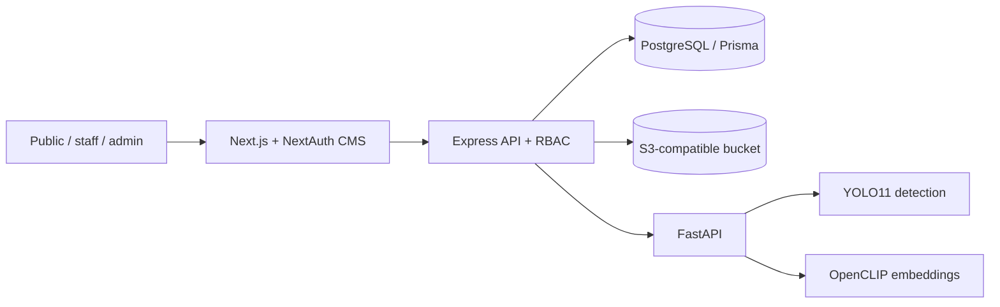

<a id="readme-top"></a>

<div align="center">

# Lensistry

**See it. Search it. Know it.**

Standalone AI-powered product/SKU catalog and shelf-photo identification proof of concept, built by **DLSU STSWENG Group 18**.

[Overview](#overview) · [Architecture](#architecture) · [Setup](#local-development) · [API](#api-contracts) · [Validation](#validation) · [Gitflow](#gitflow)

</div>

> **Development status (October 2026):** The repository contains a working implementation of web/API routes and a model inference scaffold, but deployment, live database/S3 integration, model quality and full end-to-end behavior still require environment-dependent verification. The client-requested stack is implemented independently of Skaffld CORE; integration is future work.

## Overview

Lensistry helps administrators maintain a SKU catalog with reference photos; staff can upload shelf photographs, find several objects, compare them with indexed SKUs, inspect scores, and correct mistakes. Public visitors can search catalog metadata without authentication.

| Capability                                                                             | Current state                                                                                   |
| -------------------------------------------------------------------------------------- | ----------------------------------------------------------------------------------------------- |
| Public catalog search by name, brand or SKU                                            | Implemented through Express and Next.js                                                         |
| Staff/CMS sign-in and admin-managed staff users                                        | NextAuth credentials with Express-issued JWT and database-backed role checks                    |
| Product CRUD, reference photos and indexing states                                     | Implemented; admin only                                                                         |
| Shelf photo uploads, detection, similarity matching and history                        | Implemented as synchronous POC workflow; requires running AI models and object storage          |
| Unknown detections, bounding-box coordinates, similarity scores and manual corrections | Implemented in API/history UI; image overlay and calibrated probabilities are not yet available |
| Text embeddings / semantic natural-language search                                     | Not implemented; text search is database substring matching                                     |
| Object-detector training/fine-tuning, asynchronous jobs, batch evaluation              | Not implemented; next phase                                                                     |
| Skaffld CORE sync / migration                                                          | Not implemented; application owns its catalog, identity and database                            |

## Architecture

The client-aligned technology stack is:

| Layer                 | Technology                                                                                                       |
| --------------------- | ---------------------------------------------------------------------------------------------------------------- |
| Frontend/CMS          | **Next.js 16**, React 19, TypeScript 7, Tailwind CSS 4, **Radix UI** via shadcn/ui                               |
| Main backend          | **Node.js**, **Express 5**, TypeScript, Zod                                                                      |
| Database              | **PostgreSQL 18**, **Prisma ORM 7** and reviewed SQL migrations                                                  |
| Authentication        | NextAuth 5 credentials CMS sessions, short-lived **JWT access tokens** for API calls, backend-enforced **RBAC**  |
| Images                | **S3-compatible storage** with presigned uploads (MinIO in development; other compatible providers configurable) |
| AI                    | Python 3.11–3.13, **FastAPI**, **PyTorch**, **Ultralytics YOLO11**, **OpenCLIP ViT-B/32**                        |
| Dependency management | Bun for JavaScript workspace; uv for Python                                                                      |
| Tests/quality         | Node test runner, Python pytest/HTTPX, Oxlint, Oxfmt, Ruff                                                       |



Express owns data, credential checks, privileged operations and access to storage. Next.js routes and Server Actions are the browser-facing entry points; Python is a separate inference runtime. Feature code is grouped in `src/modules/` and `api/src/modules/`; the API, web app and AI service communicate across explicit HTTP boundaries. No Skaffld CORE dependencies are required. Future synchronization should use stable SKU identifiers and versioned APIs, with deliberate identity mapping.

### Image indexing versus training

**Indexing** does not fine-tune a neural network. Administrators upload JPEG/PNG/WebP reference photos (10 MiB each), then request indexing. The API downloads the objects, validates image contents, and asks FastAPI for a normalized OpenCLIP image embedding per reference. Prisma stores the vector and model ID, and records `PENDING → PROCESSING → INDEXED` or `FAILED`. Indexing can be retried. The current 512-dimensional vectors are kept as PostgreSQL float arrays and compared in the API for this small POC; a vector index should be considered only when catalog size warrants it.

**Detection** runs a general-purpose `yolo11n.pt` detector on a shelf photo. Each bounding-box crop is embedded with the same OpenCLIP model and compared using cosine similarity to indexed reference embeddings. Similarity below `0.78` yields **Unknown**. This threshold is an **uncalibrated heuristic** and similarity is not a probability. YOLO11n has not been trained on the project's SKU labels, so detection coverage can be poor for packaging, crowded shelves or uncommon products. Manual SKU corrections are stored separately from the AI prediction. Annotated product-specific images and detector fine-tuning are the future **training** phase, distinct from indexing.

Requests currently run synchronously for simplicity. A queue (Celery/Redis or a simpler durable worker) should be introduced only after measurements show that inference latency, retry behavior or batch volume require it.

## Local development

Prerequisites: Git, **Node.js** for the Express API, **Bun 1.4.3**, Docker Compose (Postgres/MinIO), **Python 3.11–3.13** and [uv](https://docs.astral.sh/uv/). Python inference models require significant disk space and CPU/GPU memory; weights may download on first inference. Do not put live secrets in version control.

1. Clone the repository, then run `bun install --frozen-lockfile` (use `bun install` when intentionally updating `bun.lock`).
2. Copy `.env.example` to `.env` at the repository root. Set independent, random **32+ character** values for `AUTH_SECRET` and `JWT_SECRET`; keep `DATABASE_URL`, `S3_*`, `API_URL`, `WEB_ORIGIN` and `AI_SERVICE_URL` consistent with your services. The example MinIO credentials are local-development defaults only.
3. Run `docker compose up -d`. This starts PostgreSQL on port **5432** and MinIO API/console on **9000/9001**, and provisions the `lensistry` bucket. Set production passwords and persistent storage separately.
4. Run `bun run db:generate` followed by `bun run db:migrate`. The initial reviewed SQL is in `api/prisma/migrations/20261030000000_initial/`. **Migrations modify the specified database**; verify `DATABASE_URL` first.
5. Temporarily set `ADMIN_EMAIL`, `ADMIN_PASSWORD` (at least 12 characters) and optionally `ADMIN_NAME` in your shell or local env; run `bun run db:seed-admin`, then clear those values from shell history/environment where practical.
6. Run the AI service with `cd services && uv sync --extra dev && uv run uvicorn app.main:app --reload --port 8000`.
7. In separate terminals from the repository root, start the Express API with `bun run dev:api` (port **4000**) and the Next.js web app with `bun run dev` (port **3000**). Open `http://localhost:3000` or `/sign-in`.

The API loads the root `.env`; Prisma CLI configuration reads the same file. API and AI health endpoints are `GET /health` on ports 4000 and 8000 respectively. S3 presigned URLs are generated using the configured `S3_ENDPOINT`; browser uploads must be able to reach that endpoint. In hosted deployments configure S3 CORS, private bucket permissions, TLS and actual domain origins. The initial local services are development fixtures, not hardened production configuration.

**Environment summary:** `DATABASE_URL`, `API_PORT`, `API_URL`, `WEB_ORIGIN`, `AUTH_SECRET`, `JWT_SECRET`, `JWT_ISSUER`, `JWT_AUDIENCE`, `S3_ENDPOINT`, `S3_REGION`, `S3_BUCKET`, `S3_ACCESS_KEY_ID`, `S3_SECRET_ACCESS_KEY` and `AI_SERVICE_URL`. Set optional `YOLO_WEIGHTS` in the AI service to use your own compatible detector weights.

## API contracts

Express provides JSON endpoints, with Zod validation and role checks at the backend:

| Method            | Path                                   | Role                                      |
| ----------------- | -------------------------------------- | ----------------------------------------- |
| POST              | `/auth/login`                          | Public credential exchange (rate limited) |
| GET               | `/auth/me`                             | Signed-in                                 |
| POST              | `/auth/users`                          | Admin                                     |
| GET               | `/products`, `/products/:id`           | Public                                    |
| POST/PATCH/DELETE | `/products`, `/products/:id`           | Admin                                     |
| POST              | `/products/:id/images`                 | Admin; returns a presigned S3 PUT URL     |
| POST              | `/products/:id/index`                  | Admin; synchronous reference embedding    |
| GET/POST          | `/repository`                          | Staff/admin                               |
| POST              | `/repository/:id/analyze`              | Staff/admin; YOLO and matching            |
| GET               | `/repository/searches/recent`          | Signed-in staff/admin; own searches       |
| PATCH             | `/repository/searches/:id/matches/:id` | Search owner or admin; manual correction  |

Images are stored in S3-compatible storage; only object keys and metadata are stored in PostgreSQL. JWT validation verifies issuer, audience, expiry and the current user/role in the database. Direct API access cannot bypass these checks. NextAuth sessions are intended for the CMS; there is no public self-registration workflow.

## Validation

From the repository root:

```bash
bun run lint
bun run format:check
bun --bun next typegen
bun run typecheck
bun run typecheck:api
bun run test:api
bun run build
```

Python's lightweight API validation tests run with `cd services && uv run --extra dev pytest -q` after installing dependencies. `uv run --extra dev ruff check .` checks Python style. Full detector and embedding inference must also be verified with actual weights and representative product images. There are currently no configured Playwright browser tests or measured accuracy benchmarks; a passing static build or mocked unit tests do **not** prove production readiness.

**Proposed POC acceptance gates (to confirm with client; none measured yet):** evaluate a held-out, SKU-stratified set of annotated shelf photos including lookalike packaging, occlusion, varying angles and lighting; target detector `mAP@0.5 ≥ 0.75` and recall `≥ 0.80`; top-1 SKU identification accuracy `≥ 0.90` on correctly detected known objects; unknown-product false acceptance `≤ 5%`. Also report end-to-end precision/recall, error by SKU and camera-angle subgroup, latency p50/p95, and manual-correction rate. Calibrate the matching threshold only on a validation split, then freeze it for test data.

## Roadmap and limitations

Near term: live smoke tests against PostgreSQL/MinIO and downloaded AI weights; bounding-box overlays and reference-image previews; meaningful integration and browser tests; measured detection/matching benchmarks; file lifecycle cleanup and batch job durability. Later: train a product-specific detector using labeled data (e.g. CVAT), add a scalable vector index and natural-language retrieval, design API versioning / SKU mapping for optional Skaffld integration, and add deployment-specific security and monitoring. Avoid claiming these as shipped until implemented and verified.

## Gitflow

Use `feature/*` branches from `development`, propose pull requests back to `development`, and require passing CI, QA review and at least one approval before merge. `release/*` branches stage approved releases, while `hotfix/*` handles urgent mainline fixes. Never push directly to the protected `main` or `development` branches. CI checks lint, formatting, web/API types, unit tests, Python checks and the web build; configure branch protections in GitHub separately.

## Contributing

Work in small vertical feature slices, validate inputs and RBAC on every server boundary, never commit credentials, model weights or customer images, and document tests and integration limitations in PR descriptions. Review database migrations against the targeted database before applying.

<!-- TEAM -->

## Team

**De La Salle University–Manila**  
**College of Computer Studies**  
**STSWENG Group 18 · Term 1, A.Y. 2026–2027**

| Team member            | Email                              | Section | Primary role  | Secondary role |
| ---------------------- | ---------------------------------- | ------- | ------------- | -------------- |
| Carlo Gabriel Barreo   | <carlo_barreo@dlsu.edu.ph>         | S06     | QA            | Ops            |
| Hadjj Garcia           | <hadjj_garcia@dlsu.edu.ph>         | S06     | Analyst       | —              |
| John Benedict Garcia   | <john_benedict_garcia@dlsu.edu.ph> | S03     | Developer     | QA             |
| James Ryan Guinto      | <james_guinto@dlsu.edu.ph>         | S06     | Analyst       | QA             |
| Kim Francis Herrera    | <kim_herrera@dlsu.edu.ph>          | S06     | Ops           | Product Owner  |
| Rintaro Iwata          | <rintaro_iwata@dlsu.edu.ph>        | S06     | Developer     | Ops            |
| James Benedict Marquez | <james_marquez@dlsu.edu.ph>        | S06     | Product Owner | Analyst        |
| Bryce Jeswin See       | <bryce_see@dlsu.edu.ph>            | S03     | QA            | Ops            |

<p align="right">(<a href="#readme-top">back to top</a>)</p>

<!-- LICENSE -->

## License

**Proprietary / All Rights Reserved.**

This project and its source code, documentation, designs, models, and assets are proprietary. No part may be copied, modified, distributed, sublicensed, or used in any form without prior written permission from the copyright holder. Access to this repository does not grant any license or ownership rights.

<p align="right">(<a href="#readme-top">back to top</a>)</p>

<!-- CONTACT -->

## Contact

For project-related questions, contact the **STSWENG Group 18** maintainers through the project's GitHub repository once its location and issue-reporting process have been published. Client contact details are intentionally not included in this public-facing README.

<p align="right">(<a href="#readme-top">back to top</a>)</p>

<!-- ACKNOWLEDGMENTS -->

## Acknowledgments

- **De La Salle University–Manila, College of Computer Studies** — academic project setting.
- **Project client and reviewers** — requirements and feedback informing the product proposal and development plan.
- **[Best-README-Template by othneildrew](https://github.com/othneildrew/Best-README-Template)** — README structure adapted from [`BLANK_README.md`](https://github.com/othneildrew/Best-README-Template/blob/main/BLANK_README.md).

<p align="right">(<a href="#readme-top">back to top</a>)</p>
