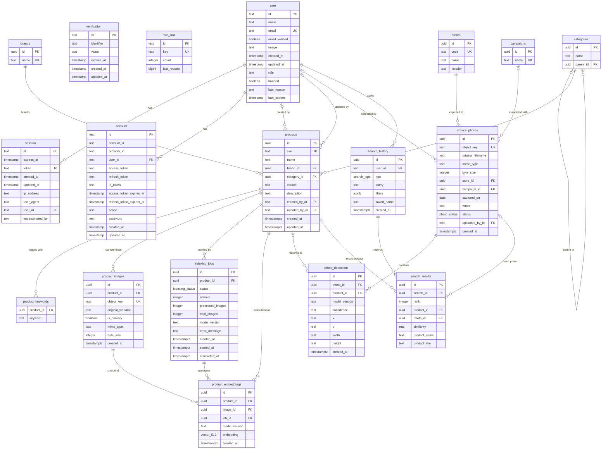

# Lensistry database ERD

This entity–relationship diagram reflects the **current Drizzle ORM schema** in
`src/modules/{auth,catalog,indexing,repository,search}/db/` (18 tables, 22
foreign keys). It describes the database structure, not the implementation
status of application features.

**Cardinality:** `||` means exactly one; `o|` means zero or one; `o{` means
zero or many. The left side of each line is the referenced table. Optional
relationships correspond to nullable foreign-key columns. In particular,
deleted products can leave detections and saved search results intact, while
their `product_id` becomes `NULL`.

**Additional constraints:** `product_keywords` uses a unique **pair**
(`product_id`, `keyword`) instead of a single-column primary key;
`categories` uniquely indexes (`name`, `parent_id`), and `product_embeddings`
uniquely indexes (`job_id`, `image_id`). The schema also defines check
constraints for uploaded-image types/sizes, nonnegative indexing progress,
positive search ranking, normalized photo bounding boxes, and score ranges.
The `verification` and `rate_limit` Better Auth tables have no foreign keys.

**Storage and search:** `product_embeddings.embedding` is a 512-dimensional
pgvector with an HNSW cosine index. Image content resides in object storage;
`product_images` and `source_photos` store its object keys. Enumerated statuses
are `indexing_status`, `photo_status`, and `search_type`.

Source: [`src/lib/db/schema.ts`](../src/lib/db/schema.ts) and its imported
module schemas. Implementation considerations are documented in
[`database.md`](database.md).
